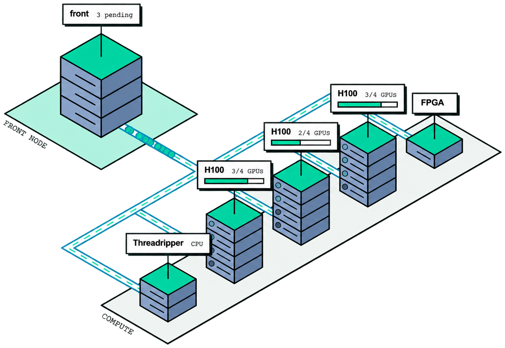

<p align="center">
  
  
  
  
  
  
  
  
</p>

<p align="center">
  
</p>

<p align="center">
  <a href="https://github.com/enajx/nanoHPC/actions/workflows/python-tests.yml"></a>
  <a href="https://github.com/enajx/nanoHPC/actions/workflows/public-demo.yml"></a>
  <a href="LICENSE"></a>
</p>

`nanoHPC` is a lightweight Slurm cluster and monitoring tool for small computational labs.

In Slurm mode, one `cluster.yml` defines the machines, users, partitions, and queue policy. One command sets up every
machine. Monitor mode also uses a `cluster.yml` to set up monitoring without Slurm.

- A single `cluster.yml` for machines and users, plus partitions and queue policy in Slurm mode.
- Slurm scheduling for GPU and CPU jobs, with fair-share and per-user limits.
- A ready-made website showing machine health and GPU use, plus the job queue in Slurm mode.
- Playbooks for setup, node changes, policy updates, and nightly backups.
- Automatic health checks and optional Slack alerts for machine issues and failed backups or deploys.
- Isometric visualisation of the cluster topology in real time:

<div align="center">
  
</div>

See a [demo of nanoHPC](https://najarro.science/nanoHPC/).

## Set up

You need:

- Machines running Ubuntu 22.04, 24.04, or 26.04. Slurm mode supports NVIDIA GPU and CPU-only compute machines;
  monitor mode also works with CPU-only machines.
- SSH access to every machine as an administrator with sudo.
- [uv](https://docs.astral.sh/uv/) installed.

**1. Install nanoHPC locally**

```sh
uv tool install git+https://github.com/enajx/nanoHPC
```

**2. Describe your cluster with the setup wizard**

```sh
nanohpc init cluster.yml
```

The wizard reads your machines over SSH without changing them and walks you through the choices for the selected mode.
It writes `cluster.yml` and tells you if anything on a machine is missing. You can also write the file yourself from the
[example](examples/cluster.yml).

**3. Deploy**

```sh
nanohpc validate cluster.yml
nanohpc deploy cluster.yml --dry-run    # shows what would change
nanohpc deploy cluster.yml
```

That's it! Slurm is running, and monitor website is running and accessible through the DNS or public IP of the host machine.

**4. Making changes after deployment**

Edit `cluster.yml` (or run the wizard again), then deploy again, or only the part you changed:

```sh
nanohpc deploy cluster.yml --only users      # also: policy, partitions, node NAME
nanohpc check cluster.yml                    # report every machine against cluster.yml
```

If you prefer having your AI agents setting up the cluster, you can point them to
[SETUP-for-AGENTS.md](SETUP-for-AGENTS.md).

### Deploy Monitor only (without Slurm)

Monitor mode shows machine health, GPU use, usage history, and existing login names on a website. It does not set up
Slurm, user accounts, SSH access, or storage. Choose one machine as the monitor host; it can also run work.

```sh
nanohpc init cluster.yml --mode monitor
nanohpc validate cluster.yml
nanohpc deploy-monitor cluster.yml --dry-run
nanohpc deploy-monitor cluster.yml
```

You can also write the file yourself from the [monitor-mode example](examples/monitor.yml).

## Tech stack

<p>
  
  
  
  
  
  
  
  
</p>

- `Ansible` runs the setup on every machine; `nanohpc` writes its inventory and variables from `cluster.yml`.
- `Slurm` with `Munge` schedules CPU and GPU jobs on the compute machines.
- `NFS` shares `/home` with disk quotas in Slurm mode; `rsync` backs it up every night.
- `Prometheus` tracks metrics and `Grafana` renders them in the monitoring dashboards; `Alertmanager` sends the
  Slack alerts.
- `React`, `TypeScript`, and `Vite` for the website, served by `nginx` with `Let's Encrypt` or your own certificate.
- `Textual` for the setup wizard.
- `Lima` VMs for the simulated test cluster; Python `unittest` and `Playwright` for the tests.

## License

[MIT](LICENSE)
